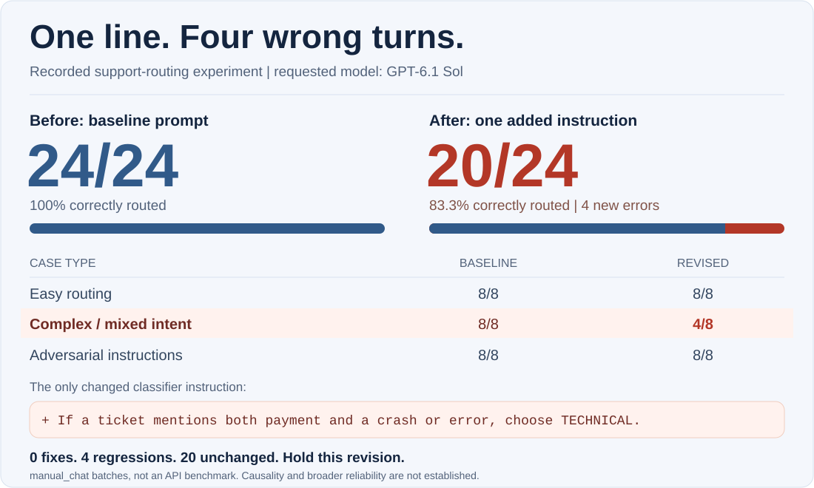

# Decision Debugger

**Know whether your next prompt fix helps customers, or just moves the problem.**

For product managers and AI product teams, a convincing prompt edit is not enough.
You need to know which customer problems it fixes, what it breaks, and whether
the evidence supports shipping it.

Decision Debugger demonstrates that decision workflow: turn a customer failure
into a testable hypothesis, review a small instruction change, and compare
improvements **and regressions** on the same examples.

**This release is a runnable offline product demo.** Responses and diagnostic
notes are authored synthetic examples; scoring and comparison are real code.
It is not a live-model benchmark.



## Customer problem and business value

Imagine an AI support router sending "the payment page crashes" to billing rather
than technical support. The customer may face another handoff instead of getting
help. A PM can clarify the routing instructions, but an overly broad fix might
then send a genuine refund request to the wrong team.

| Product question | What the workflow makes visible | Why it matters |
| --- | --- | --- |
| Which customer need is being missed? | A concrete ticket, expected route, and observed answer | Turns "the AI is wrong" into a reproducible product problem |
| Why try this particular change? | A development-case hypothesis, a targeted check, and one prompt diff | Makes the proposed fix reviewable rather than anecdotal |
| Is the change better overall and safe for other cases? | Fixes, regressions, and separate validation results | Supports a ship, revise, or hold decision instead of relying on one headline score |

**The business goal:** fewer incorrect handoffs and a better path to resolution.
A real pilot would measure re-routing, repeat contacts, resolution time, and
regressions. **This demo does not measure those business outcomes or claim cost
savings.** It illustrates the evidence a PM would want before making that decision.

The PM work is problem framing, defining correct behavior, testing a hypothesis,
and explaining the release trade-off, not simply writing a longer prompt.

## Demo results

**Illustrative results, not measured model performance.** Eight synthetic support
tickets are classified as `BILLING` or `TECHNICAL`. The saved baseline sometimes
prioritizes payment wording over a technical failure.

The walkthrough inspects a development failure, shows a saved wording-change
check, and proposes one additional instruction:

> If a ticket mentions both payment and a crash or error, choose TECHNICAL.

| Cases | Baseline | Revised |
| --- | --- | --- |
| Development | 2/4 correct (50%) | 3/4 correct (75%) |
| Validation | 3/4 correct (75%) | 3/4 correct (75%) |
| Overall | 5/8 correct (62.5%) | 6/8 correct (75%) |

**Two fixes, one regression, five unchanged cases, zero unresolved comparisons.**

| Customer example | Saved baseline | Saved revision | Product implication |
| --- | --- | --- | --- |
| Payment page crashes before submitting a card (`dev-002`) | BILLING | TECHNICAL | One technical problem is now routed correctly |
| Reverse a duplicate charge after a checkout error (`dev-004`) | BILLING | TECHNICAL | A billing request is newly routed incorrectly |

**PM takeaway: a higher total is not an automatic ship decision.** The edit
introduces a billing regression, validation stays at 3/4, and `val-004` remains
wrong. The next investigation would be the billing exception and better independent
cases, not a claim that the prompt is fixed.

Read the [complete demo report](examples/expected_output.txt) or inspect the
[examples and saved responses](decision_debugger/demos/support_tickets.json).
The hypothesis is not access to hidden model reasoning. Real-model results have
not been published; model ID, token usage, latency, and cost are unknown.

## Run it yourself

You need **Git and Python 3.12 or newer**. No third-party packages, API key,
model account, or server is required. After cloning, the demo runs entirely offline.

Clone the repository and start the walkthrough:

```console
git clone https://github.com/shshubhe/decision-debugger.git
cd decision-debugger
python -m decision_debugger
```

The first command inside the project shows the original instructions, baseline
answers, a selected failure, a saved hypothesis and check, and the exact prompt
diff. It stops before revealing revised results.

After reviewing the diff, approve the **saved demonstration edit**:

```console
python -m decision_debugger --approve-demo-edit
```

You will see the before/after table, including the regression above. Both commands
only print a report: they do not call a model, change files, or generate responses.
There is **no `pip install` step**; a virtual environment is optional.

On macOS/Linux, use `python3` if `python` is unavailable. On Windows, `py -3.12`
can replace `python`. Alternatively, download the repository ZIP from GitHub,
unpack it, and run the Python commands from its root folder.

### Can I test my own prompts or models?

Not with the current CLI. It replays this fixed classification example.
Live connections, arbitrary dataset imports, extraction, a web UI, and persistent
run storage are not implemented. Edited fixtures are not new inference results.
Repeatedly tuning against validation examples also weakens their independence.

## Reproducibility and standalone archive

The standard-library tests need no installed packages and make no model calls:

```console
python -S -m unittest discover -s tests -v
```

Build a standalone archive without installing build tools:

```console
python -S -m tools.build_demo
```

From the resulting `dist` directory:

```console
python -I -S decision-debugger.pyz --approve-demo-edit
```

The archive needs Python but not the checkout. Its explicit file allowlist
contains only the runtime, synthetic fixture, README, illustration, and license.
CI covers Python 3.12-3.14 on Windows and Linux.

Prompt, dataset, and configuration hashes bind saved responses to their
snapshots; stale edits are rejected rather than shown as fresh inference.
Hashes are not signatures or proof that a model ran. Shared scoring keeps
invalid, failed, and absent responses in the denominator and flags non-prompt
changes as confounded comparisons.

## Contributing and license

See [CONTRIBUTING.md](CONTRIBUTING.md) and [SECURITY.md](SECURITY.md).
Licensed under [MIT](LICENSE).
